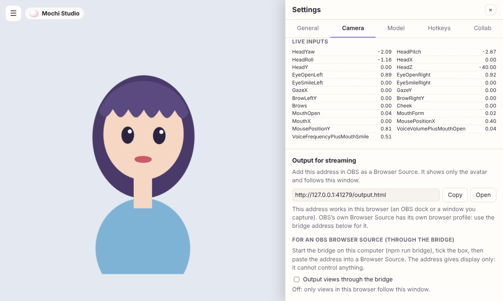
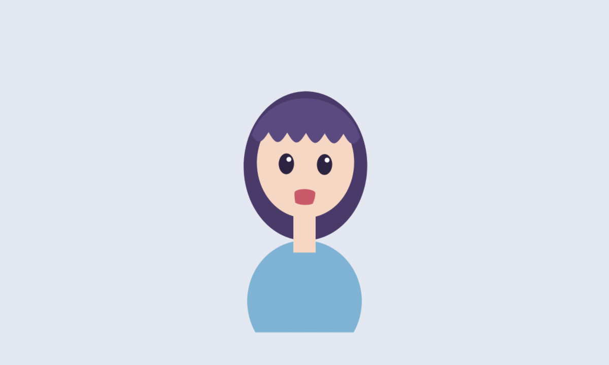
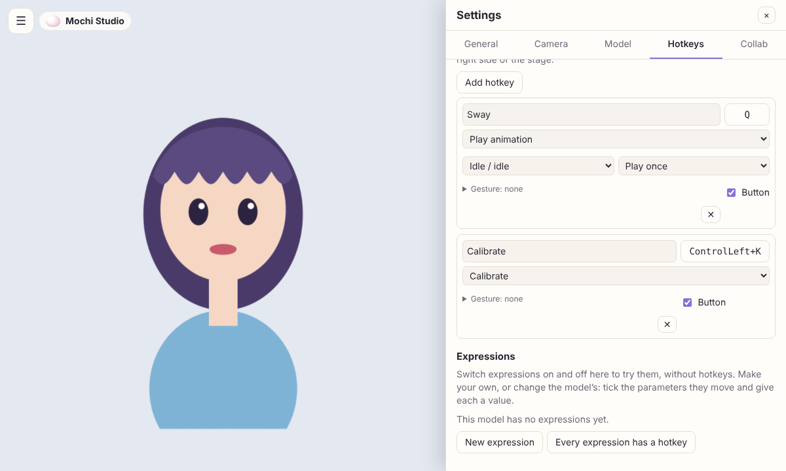

# Mochi Studio

An open-source live-avatar app for models made with Live2D Cubism
(`.moc3` + `.model3.json`), built on the Mochi2D runtime. Animate your avatar
with your webcam and microphone, and stream it with OBS. It is designed to be
driven by AI agents as well as by people: an MCP server and a WebSocket API,
through a small local bridge ([docs/agent-api.md](docs/agent-api.md),
[llms.txt](llms.txt)).


_The main window: the sample model «Mochi» on the stage, and the inputs face tracking measures._


_The mapping editor: each tracking input to a model parameter, with its ranges, smoothing and live values._


_The output view, as OBS shows it: the model alone, following the main window._


_Hotkeys: motions, expressions, items and more, on keys, on-screen buttons or hand gestures._

The pictures are generated with the sample model and a recorded, synthetic
tracking session (`npm run screenshots`).

> **Status:** a working app, in the browser and as an unsigned desktop app
> for Linux, Windows and macOS, on Mochi2D 0.21.0 (vendored in `vendor/`).
> Face, hand and voice tracking, items, hotkeys, the settings import, the
> plugin API, the agent API, Spout2 output (Windows), a virtual camera
> (Linux) and collaborations are built and tested. Not yet: the virtual
> camera on Windows and macOS, and signed builds.
>
> **No signaling server is set or run.** Collaborations need one: the app
> sets none, and the project runs none. Run your own, or use one someone
> you trust runs ([docs/collaboration.md](docs/collaboration.md#hosting-a-server)).

**How it was made.** Most of this code was written by AI coding agents (Anthropic's Claude) under the direction of the project's maintainer, through the clean-room process in [CLEANROOM.md](CLEANROOM.md). Copyright may not subsist in every part of it. To the extent it does, it is licensed under the MIT License. Either way, it is provided as is, without warranty. Third-party code keeps its own licenses ([THIRD_PARTY_NOTICES.md](THIRD_PARTY_NOTICES.md)).

## Features

- Load a model from a folder, a zip or a URL. Settings are saved per model in
  the browser (IndexedDB) and can be exported and imported as JSON.
- Face tracking in the browser with MediaPipe's face landmarker: head pose and
  52 blendshapes, a neutral-pose calibration and a One Euro smoothing filter.
  Hand tracking and hand-gesture hotkeys too, and a phone on the same
  network can track the face instead (its camera picture stays on the
  phone).
- A mapping editor: any tracking input to any model parameter, with input and
  output ranges, inversion, clamping and smoothing. The mouse pointer and a
  game controller (sticks, buttons, triggers) are inputs too, and
  controller buttons can be hotkey keys.
- Lip sync from the microphone with Mochi2D's live lip sync, combined with the
  tracked mouth in a way you choose.
- Items (props such as an umbrella or a hat): further models drawn over the
  avatar, placed by dragging or numerically, and pinned so they follow the
  body.
- Hotkeys and on-screen buttons for expressions, motions and items.
- A clean output view for OBS with a transparent, chroma-key, solid or image
  background (app-wide or per model), position, zoom, rotation and a
  frame-rate cap.
- Import of a model's settings files made for VTube Studio (`.vtube.json`):
  mappings, hotkeys, idle motion.
- Spout2 output to OBS on Windows, and a virtual camera for call apps on
  Linux, from the desktop app.
- Collaborations: up to six people's avatars on one stage, over WebRTC,
  with video-only models by default ([docs/collaboration.md](docs/collaboration.md)).
- Hotkeys of up to three keys held together, with "while held" and "for N
  seconds" options.
- One command layer for the UI and agents, with undo and a replayable log.
- An agent API: `mochi-studio-bridge`, a local bridge with an MCP server
  (screenshots as images) and a WebSocket API. Off by default, localhost
  only, a token per connection, scopes, and an indicator while an agent is
  connected.
- Privacy: camera and microphone are processed locally and never recorded,
  stored or sent, to agents neither; the header shows when either is on.

## Getting started

- In a browser: `npm ci`, then `npm run dev`.
- As a desktop app with the bridge built in (unsigned builds):
  [docs/desktop.md](docs/desktop.md).

Requires Node.js 22 or later.

```sh
npm ci
npm run fetch:models
npm run dev
```

Open the address Vite prints, then load a model with **Open folder…**. No
model yet? **Try the sample model** on the empty stage loads «Mochi», a small
model that comes with Mochi Studio ([samples/](samples/README.md)), in the
browser and the desktop app alike. See
[docs/user-guide.md](docs/user-guide.md), including OBS setup. Plugins made for VTube Studio can connect too:
[docs/plugins.md](docs/plugins.md). A test plan for real webcams, microphones, OBS, Windows,
macOS and graphics cards is in [docs/testing.md](docs/testing.md).

## Development

```sh
npm run check          # formatting, type-check, unit tests
npm run test:browser   # build, then browser tests in headless Chromium
npm run format         # apply formatting
npm run notices        # rewrite THIRD_PARTY_NOTICES.md from what the build bundles
```

- `src/core/`: the app logic, with no browser dependency (tracking inputs,
  filter, calibration, mapping, lip-sync mixing, hotkeys, settings, model
  files, output sync protocol, the settings import, the command layer in
  `commands/`, and the bridge protocol).
- `desktop/`: the Electron app (`npm run desktop`, `npm run desktop:package`),
  which runs the bridge itself.
- `bridge/`: `mochi-studio-bridge` (`npm run bridge`), the local bridge and
  MCP server. Node runs its TypeScript directly (Node 22.18 or later).
  `npm run agent:catalog` updates `bridge/catalog.json` and the command table
  of the agent docs from the command registry.
- `src/web/`: the browser app: the control window (`index.html`), the output
  view (`output.html`), the phone tracker's page (`phone.html`, served by the
  bridge on the local network), MediaPipe, IndexedDB and the renderer
  adapter.
- `test/fixtures/`: tracking recordings used by tests.
- `test/support/syntheticModel.ts`: a made-up test model built in code with
  Mochi2D's `writeMoc`, so tests render without any real model data.
- Browser tests need Chromium; set `CHROMIUM_PATH` to use an installed one.
- `assets/models/`: put local test models here. It is gitignored; never
  commit model data.

## Contributing and security

See [CONTRIBUTING.md](CONTRIBUTING.md) (building, testing, the sign-off and
the clean-room statement) and [SECURITY.md](SECURITY.md) (reporting a
vulnerability).

## License

MIT. See [LICENSE](LICENSE). The third-party software the app ships with,
and its licenses, are listed in
[THIRD_PARTY_NOTICES.md](THIRD_PARTY_NOTICES.md). The terms of use are
in [TERMS.md](TERMS.md): you are responsible for having the right to use,
stream and share the models and items you load.

## Patents

This project is licensed under the MIT License, which grants no patent rights. Reading some model files uses techniques, such as joining meshes ("glue") and blend shapes, that may be covered by third-party patents in some countries, including Japan and the United States. The project has taken no legal opinion on this, and makes no statement that any patent is or is not infringed. If you use or distribute it in such a country, above all commercially, check for yourself whether you need a license.

---

Live2D and Live2D Cubism are trademarks or registered trademarks of Live2D Inc. VTube Studio is a product of DenchiSoft. Mochi Studio is an independent project. It is not affiliated with, endorsed by, sponsored by or supported by either, and it contains none of their code or files.
